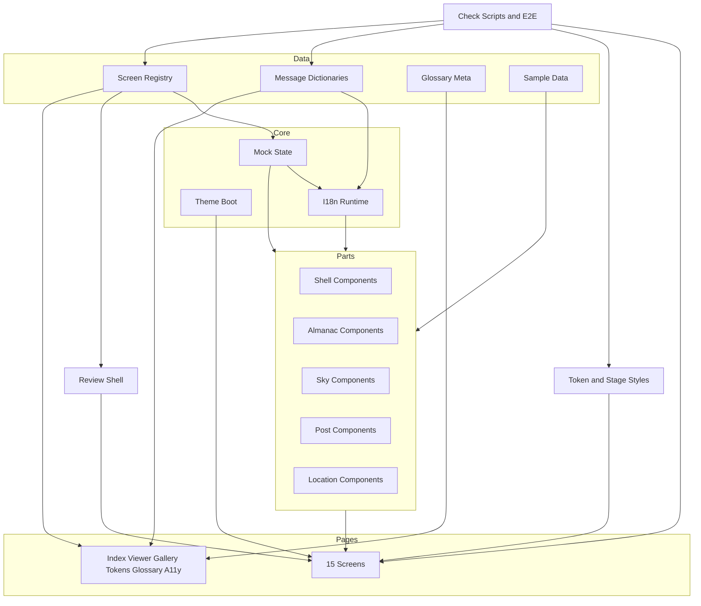
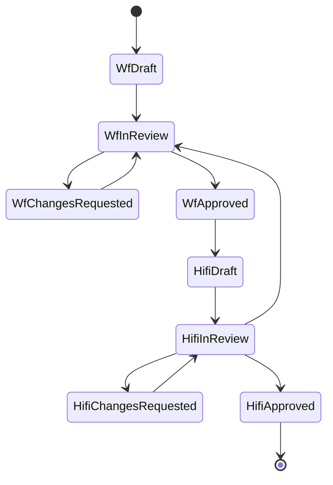
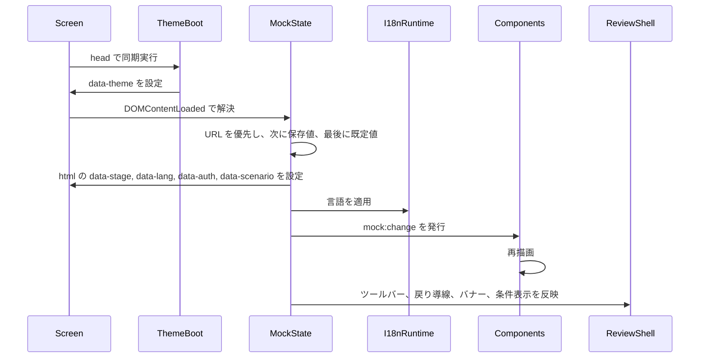

# Design Document: ui-mockups

## Overview
**Purpose**: 本機能は、日本の暦・天文・星図・投稿コミュニティを提供する Web サービスの全主要画面について、ワイヤーフレームとハイフィデリティの 2 段階の静的モック、デザイントークン、日英用語集を提供する。これらを、後続の全機能 spec が参照する UI の基準とする。

**Users**: 開発者（＝レビューする人）は、ローカルのブラウザでモックを開き、段階・言語・テーマ・ログイン状態・シナリオを切り替えてレビューする。後続 spec の実装者は、トークン・部品・用語集を実装の基準として参照する。

**Impact**: リポジトリ直下に、依存なしで開ける `mockups/` を新設する。既存コードはない。

### Goals
- 15 画面を、ワイヤーフレームとハイフィデリティの 2 段階で、1 つのマークアップから表示する
- ログイン状態・空状態・エラー・非公開・一時非表示・削除済みなどの状態を、画面上で切り替えて確認できる
- 「夜空・天文」トーンのライト/ダーク両テーマと、名前付きデザイントークンを確定する
- 日英の全文言と暦注・天文用語を、言語に依存しない識別名で管理する
- コントラスト、はみ出し、トークン以外の値の使用、辞書の欠落、オフライン表示を、機械的に検査できる

### Non-Goals
- 実データの取得、暦・天文の正確な計算、認証、保存などの動作する機能
- 本番フレームワークでの実装、ビルドの仕組み、パッケージ管理の基盤（platform-foundation が担う）
- 星図の正確な天体位置、地図の実タイル
- 日英以外の言語の辞書
- 共有 URL での公開

## Boundary Commitments

### This Spec Owns
- `mockups/` 配下のすべての成果物：画面、部品、レビューの仕組み、サンプルデータ、検査ツール
- デザイントークンの名前と値（ライト/ダーク）。後続 spec に引き渡す正本とする
- 日英の UI 文言と、暦注・天文用語の対訳、英訳の方針、メッセージキーの命名規約
- 画面の一覧と、段階ごとのレビュー状態（画面レジストリ）
- 各画面の情報構成と、状態ごとの見え方の定義

### Out of Boundary
- 暦注・天文現象・出没時刻・天気の正しい値（サンプル値は見た目を示すだけ）
- 通報の閾値件数、位置の丸め方、公開範囲の判定ロジックなど、機能の振る舞いの決定（各機能 spec が決める）
- 本番の i18n ライブラリへの移行、トークンの本番 CSS への取り込み（platform-foundation）
- Web フォントの採用、画像やアイコンのアセット制作の外注
- プライバシーポリシー・出典表示の正式な文面（モックでは章立てと例文のみ）

### Allowed Dependencies
- ブラウザ標準の機能のみ：Custom Elements v1、CSS カスタムプロパティ、`Intl.DateTimeFormat`、`localStorage`（失敗を許容）
- 開発者用の検査に限り、Node.js 22 以降、`@playwright/test`、`typescript`（型検査のみ）を使える。モック本体は、これらに依存してはならない。`mockups/package.json` は独立して置く。将来のモノレポのワークスペースに含めるかどうかは、platform-foundation が決める
- 外部ネットワーク上のリソース（CDN、Web フォント、地図タイル）は使わない
- 依存の向きは、型定義 → データ（レジストリ、辞書、用語集、サンプル） → 基盤スクリプト（状態、i18n、テーマ） → 部品 → 画面とする。逆向きの参照は禁止する。CSS は tokens → base → components → wireframe の順に重ねる。`review.css` は製品の CSS から参照しない

### Revalidation Triggers
- トークンの名前の変更・削除、または意味を持つ色の役割の追加・削除（platform-foundation と全 UI の spec に影響）
- メッセージキーの命名規約、またはキーの変更（platform-foundation の i18n 基盤に影響）
- 画面の追加・削除や情報構成の変更（その画面を実装する機能 spec に影響）
- 状態の定義（auth、scenario）の追加・変更（該当する機能 spec に影響）
- 位置の公開精度の段階や、投稿の状態の表示区分の変更（post-location-weather、posts-comments、moderation-reports に影響）

## Architecture

### Architecture Pattern & Boundary Map



**Architecture Integration**:
- **Selected pattern**: 単一マークアップとスキンによる段階切替、Light DOM のカスタム要素による部品化、URL を正とする状態管理。選定の比較は research.md にある
- **Domain/feature boundaries**: 部品は、将来の機能 spec の境界（暦・天文・星図・投稿・位置）に合わせて 5 ファイルに分ける。後続 spec は、自分の担当部品のファイルだけを参照すればよい
- **Existing patterns preserved**: 既存コードなし。steering 未作成のため、roadmap.md の方針（日英、拡張可能な言語、TypeScript 統一）に合わせる
- **New components rationale**: 下記の Components 表を参照
- **Steering compliance**: steering（product、tech、structure）が未作成のため、roadmap.md の制約を基準とする

### Technology Stack

| Layer | Choice / Version | Role in Feature | Notes |
|-------|------------------|-----------------|-------|
| Frontend | HTML5、CSS（カスタムプロパティ）、JavaScript ES2022 の classic script | 画面・部品・レビューの仕組み | `type="module"`、`fetch`、外部 `<use>` は使わない（`file://` の制約） |
| 型検査 | TypeScript 5.x（`checkJs`、`noEmit`）、JSDoc 型注釈 | データ・部品の契約の型検査 | `mockups/types.d.ts` に型を集約。`any` は禁止 |
| 検査ツール | Node.js 22 以降（依存なしのスクリプト） | トークン、コントラスト、辞書、レジストリの静的検査 | `mockups/tools/*.mjs` |
| E2E | @playwright/test 1.x（実装時点の最新安定版に固定） | はみ出し、オフライン、テーマ、フォーカス、ワイヤーの色の検査 | Chromium を使う。WSL2 または Windows で実行 |
| Runtime | 任意の最新ブラウザ（Chrome、Edge、Firefox） | レビューでの閲覧 | サーバ不要 |

## File Structure Plan

### Directory Structure
```
mockups/
├── index.html                      # 一覧ページ：全画面×段階のリンク、レビュー状態、各ガイドへの導線（1.5, 2.2）
├── viewer.html                     # 幅プレビュー：375px と 1440px の iframe を並べて表示（12.1）
├── components.html                 # 部品ギャラリー：mk-* 要素を状態ごとに一覧表示（2.4）
├── tokens.html                     # トークン一覧：色・文字・余白などの見本と使用例（10.5）
├── glossary.html                   # 日英用語集：分類・対訳・英訳の方針・日付時刻の書式（11.3, 11.4, 11.7）
├── a11y.html                       # アクセシビリティ方針：代替テキストの方針と記述例、フォーカス、色以外の区別（13.3〜13.5）
├── screens/                        # 15 画面。どれも同じ骨格（head、mk-site-header、main、mk-site-footer、レビューシェル）
│   ├── top.html
│   ├── calendar-month.html
│   ├── day-detail.html
│   ├── astro-events.html
│   ├── star-chart.html
│   ├── post-detail.html
│   ├── post-edit.html
│   ├── my-posts.html
│   ├── settings.html
│   ├── login.html
│   ├── report.html
│   ├── appeal.html
│   ├── admin.html
│   ├── attribution.html
│   └── privacy.html
├── assets/
│   ├── css/
│   │   ├── tokens.css              # デザイントークンの正本（ライト、ダーク×2 ブロック、ブレークポイントの値の記録）
│   │   ├── base.css                # リセット、タイポグラフィ、レイアウトの基本、フォーカス表示、フォーム
│   │   ├── components.css          # mk-* 部品とページレイアウトの製品スタイル（トークンのみ使用）
│   │   ├── wireframe.css           # html[data-stage=wireframe] の範囲で、色をグレーに再定義し装飾を消す
│   │   └── review.css              # レビュー用ツールバー・バナーの見た目（製品のスタイルと分離）
│   ├── js/
│   │   ├── theme-boot.js           # head で同期実行。保存値か URL からテーマを決め、ちらつきを防ぐ
│   │   ├── mock-state.js           # URL・保存値から MockState を解決し、変更を mock:change イベントで通知
│   │   ├── i18n.js                 # 辞書の登録、data-i18n の適用、日付時刻の書式
│   │   ├── review-shell.js         # レビュー用ツールバー、一覧への戻り、段階の状態バナー、シナリオの条件表示
│   │   └── components/
│   │       ├── base.js             # MockElement の基底クラス（mock:change で再描画）
│   │       ├── shell.js            # mk-site-header, mk-site-footer, mk-guest-notice, mk-status-badge, mk-admin-band
│   │       ├── almanac.js          # mk-month-calendar, mk-day-cell, mk-almanac-summary, mk-rise-set, mk-event-list
│   │       ├── sky.js              # mk-star-chart
│   │       ├── posts.js            # mk-post-card, mk-comment-tree, mk-like-button, mk-report-link
│   │       └── location.js         # mk-location-panel, mk-map-sample, mk-weather, mk-precision-picker
│   └── i18n/
│       ├── messages.ja.js          # 日本語の辞書（キー → 文言）
│       └── messages.en.js          # 英語の辞書（同じキーの集合）
├── data/
│   ├── screens.js                  # 画面レジストリ：ID、ファイル、許可するシナリオ、閲覧権限、段階ごとのレビュー状態
│   ├── glossary.js                 # 用語集メタ：キー、分類、英訳の方針、注記
│   └── sample-data.js              # 架空のサンプル：ユーザ、投稿、コメントツリー、暦の値、天文現象、星図、天気
├── types.d.ts                      # 全データ・部品の契約の型定義（JSDoc から参照）
├── tools/
│   ├── check-tokens.mjs            # 10.4：トークン定義以外での色・寸法リテラルの使用を検出
│   ├── check-contrast.mjs          # 13.1, 13.2：宣言した組み合わせのコントラスト比とダーク 2 ブロックの一致
│   ├── check-i18n.mjs              # 11.1, 11.5：使用キーの存在、ja と en のキー集合の一致、用語集キーの存在
│   ├── check-registry.mjs          # 1.1, 1.3, 3.1：15 画面がそろうこと、ファイルの存在、段階の承認順序
│   └── contrast-pairs.json         # 検査するトークンの組み合わせ（前景、背景、最小比）
├── tests/
│   └── mockups.spec.mjs            # Playwright の E2E（2.3, 2.6, 1.2, 9.3, 9.4, 11.2, 11.6, 12.2, 13.5）
├── tsconfig.json                   # checkJs、noEmit、strict
├── package.json                    # 開発者用スクリプト（check:*、test:e2e）と devDependencies のみ
└── README.md                       # 開き方、URL パラメータ、レビューの進め方、検査の実行方法
```

### Modified Files
- なし（greenfield）。`.gitignore` がまだないので、作成時に `mockups/node_modules/` と `mockups/.review/` を除外する

## System Flows

### 段階ごとのレビュー状態



- ハイフィの状態は、ワイヤーが `approved` になるまで `draft` から動かせない（1.3）。`check-registry.mjs` は「ハイフィが draft 以外なのに、ワイヤーが approved でない」レジストリを不正とする
- ハイフィのレビューで配置の変更が必要になった場合は、ワイヤーの `in-review` に戻す（最後の遷移）。マークアップが 1 つなので、ワイヤーで反映した変更はそのままハイフィにも現れる（1.4）
- ワイヤーが未承認の画面をハイフィ段階で開くと、レビューシェルが「未確定（ワイヤーフレーム未承認）」のバナーを出す（1.3）

### 画面表示時の状態解決



- 状態の変更（ヘッダーの言語・テーマ切替、ツールバー）は、すべて `MockState.update` を通す。URL を `history.replaceState` で更新したうえで、`mock:change` を再発行する
- 画面で許可されていないシナリオが URL に入っていた場合は `default` にし、レビューシェルが警告を出す

## Requirements Traceability

| Requirement | Summary | Components | Interfaces | Flows |
|-------------|---------|------------|------------|-------|
| 1.1, 1.2 | 2 段階のモックと、ワイヤーで配色・装飾を使わないこと | StageStyles（wireframe.css）、ScreenRegistry、全画面 | `StageId`、`[data-decor]` 規約 | 状態解決 |
| 1.3, 1.4 | ワイヤー未承認ならハイフィを確定扱いしない。変更はワイヤーに先に反映する | ScreenRegistry、ReviewShell、check-registry | `StageReview`、ScreenRegistry の不変条件 | レビュー状態 |
| 1.5 | 段階とレビュー状態を一覧で確認できる | CatalogPages（index） | `ScreenEntry.review` | — |
| 2.1 | サーバ・ビルドなしで直接開ける | 全ページ（classic script のみ） | 読み込み順の規約 | — |
| 2.2, 2.3 | 一覧ページと、一覧への戻り導線 | CatalogPages（index）、ReviewShell | `ScreenEntry.file` | 状態解決 |
| 2.4 | 部品単位の一覧 | CatalogPages（components）、全 mk-* 部品 | `MockElement` | — |
| 2.5 | 架空のサンプルデータ | SampleData | `SampleDataSet` | — |
| 2.6 | オフラインでも崩れない | システムフォント指定、インライン SVG、E2E | — | — |
| 3.1 | 15 画面 | ScreenRegistry、screens/* | `ScreenId` | — |
| 3.2 | 共通ナビゲーション | ShellComponents（mk-site-header） | `SiteHeaderAttrs` | 状態解決 |
| 3.3, 3.4, 3.5 | ログイン有無、空状態、エラーの表示例 | MockState、ReviewShell、全画面 | `AuthState`、`ScenarioId`、`data-when-*` 規約 | 状態解決 |
| 3.6 | 管理画面を区別する | ShellComponents（mk-admin-band）、admin.html | `ScreenEntry.access` | — |
| 4.1, 4.2 | 月カレンダーのセルと印 | AlmanacComponents（mk-month-calendar、mk-day-cell） | `AlmanacDay` | — |
| 4.3 | 日詳細の暦・天文・出没・投稿 | AlmanacComponents（mk-almanac-summary、mk-rise-set）、PostComponents | `AlmanacDay`、`RiseSet` | — |
| 4.4, 4.5 | 天文現象の一覧と絞り込み | AlmanacComponents（mk-event-list） | `AstroEvent`、`AstroEventKind` | — |
| 4.6 | 翌年以降の祝日を予定と表記する | AlmanacComponents（mk-day-cell、mk-almanac-summary） | `Holiday.provisional` | — |
| 4.7 | トップの要約 | top.html、AlmanacComponents、PostComponents | — | — |
| 5.1, 5.2, 5.3, 5.4, 5.5 | 全天図の描画要素、入力、日英、モバイル | SkyComponents（mk-star-chart）、star-chart.html | `StarChartSample` | — |
| 6.1, 6.4 | 投稿本文とコメントツリー、削除済みの表示 | PostComponents（mk-comment-tree） | `CommentNode` | — |
| 6.2, 6.3 | 投稿作成・編集の入力と入力エラー | post-edit.html、LocationComponents（mk-precision-picker） | `ScenarioId`（`validation-error`） | — |
| 6.5, 6.8 | 未ログインでの非公開投稿、閲覧のみの表示 | ShellComponents（mk-guest-notice）、MockState | `AuthState`、`ScenarioId`（`private-blocked`） | 状態解決 |
| 6.6 | 自分の投稿一覧と状態 | my-posts.html、PostComponents（mk-post-card）、ShellComponents（mk-status-badge、mk-pager） | `PostStatus`、`ScenarioId`（`many-items`） | — |
| 6.7 | いいねの件数と状態 | PostComponents（mk-like-button） | `LikeState` | — |
| 6.9 | ログイン中のヘッダーに未読のお知らせの件数と、お知らせへの導線 | ShellComponents（mk-site-header）、SampleData | `ReplyNotice`、`AuthState` | 状態解決 |
| 6.10 | 自分の投稿一覧のお知らせの一覧と空状態 | my-posts.html、PostComponents（mk-notice-list）、SampleData | `ReplyNotice`、`ScenarioId`（`empty`、`fetch-error`） | 状態解決 |
| 6.11 | 返信のお知らせを受け取るかの設定 | settings.html | — | — |
| 7.1 | 公開精度 5 段階の選択 | LocationComponents（mk-precision-picker） | `LocationPrecision` | — |
| 7.2, 7.3, 7.4, 7.5, 7.6 | 地域名と地図、出没、天気、取得失敗、位置なし | LocationComponents（mk-location-panel、mk-map-sample、mk-weather）、AlmanacComponents（mk-rise-set） | `PostLocation`、`WeatherSnapshot` | — |
| 8.1 | ログイン画面 | login.html | — | — |
| 8.2 | ユーザ設定 | settings.html、LocationComponents（mk-precision-picker） | `LocationPrecision` | — |
| 8.3, 8.5 | 通報の導線と画面、異議申し立て画面 | PostComponents（mk-report-link）、report.html、appeal.html | `ReportReason` | — |
| 8.4 | 一時非表示の見え方（本人と他者） | PostComponents、ShellComponents（mk-status-badge）、MockState | `ScenarioId`（`hidden-own`、`hidden-other`） | 状態解決 |
| 8.6 | 管理画面の通報キューと審査 | admin.html、ShellComponents（mk-admin-band） | `ReportQueueItem` | — |
| 9.1, 9.5 | 夜空・天文のトーン（ライトでも） | DesignTokens（tokens.css） | 色トークン | — |
| 9.2, 9.3, 9.4 | 両テーマ、外観設定への追従、手動切替 | DesignTokens、ThemeBoot、ShellComponents（mk-site-header） | `ThemePreference` | 状態解決 |
| 10.1, 10.2, 10.3 | 名前付きトークン、両テーマの値、意味を持つ色 | DesignTokens | トークン命名規約 | — |
| 10.4 | トークン以外の値を使わない | check-tokens | `TokenCheckRule` | — |
| 10.5 | トークン一覧ページ | CatalogPages（tokens） | — | — |
| 11.1, 11.2 | 全画面の日英表示と切替 | I18nRuntime、MessageDictionaries、ShellComponents（mk-site-header） | `I18nRuntime`、`LocaleId` | 状態解決 |
| 11.3, 11.4 | 用語集と英訳の方針 | GlossaryMeta、CatalogPages（glossary） | `GlossaryEntry`、`TranslationPolicy` | — |
| 11.5 | 言語に依存しない識別名 | MessageDictionaries、check-i18n | `MessageKey` 命名規約 | — |
| 11.6 | 英語で長くなっても崩れない | components.css（折り返しの規約）、E2E | — | — |
| 11.7 | 日付・時刻・曜日の書式 | I18nRuntime（`formatDate`）、CatalogPages（glossary） | `DateStyle` | — |
| 12.1 | 375px と 1440px のレイアウト | CatalogPages（viewer）、components.css | ブレークポイントのトークン | — |
| 12.2 | 360〜1920px で横スクロールなし | components.css、E2E | — | — |
| 12.3 | モバイルの月カレンダー | AlmanacComponents（mk-month-calendar） | `MonthCalendarAttrs` | — |
| 12.4 | モバイルの深いコメントツリー | PostComponents（mk-comment-tree） | `CommentTreeAttrs` | — |
| 13.1, 13.2 | コントラスト 4.5:1 と 3:1 | DesignTokens、check-contrast | `ContrastPair` | — |
| 13.3 | 色以外でも区別する | ShellComponents（mk-status-badge）、AlmanacComponents（mk-day-cell） | 記号と文字ラベルの規約 | — |
| 13.4 | 星図・地図の代替テキスト | SkyComponents、LocationComponents、CatalogPages（a11y） | `describe()` 契約 | — |
| 13.5 | フォーカス表示 | base.css（`:focus-visible`）、DesignTokens（`--color-focus`）、E2E | — | — |

## Components and Interfaces

| Component | Domain/Layer | Intent | Req Coverage | Key Dependencies (P0/P1) | Contracts |
|-----------|--------------|--------|--------------|--------------------------|-----------|
| ScreenRegistry | Data | 画面の一覧、許可シナリオ、閲覧権限、レビュー状態の正本 | 1.1, 1.3, 1.5, 2.2, 3.1, 3.6 | — | State |
| MessageDictionaries | Data | 言語ごとの文言の正本 | 11.1, 11.3, 11.5 | — | State |
| GlossaryMeta | Data | 用語の分類・英訳の方針・注記 | 11.3, 11.4 | MessageDictionaries (P0) | State |
| SampleData | Data | 架空の表示用データ | 2.5, 4.x, 5.x, 6.x, 7.x, 8.x | types.d.ts (P0) | State |
| DesignTokens | Style | トークンの正本（ライト/ダーク） | 9.1, 9.2, 9.5, 10.1〜10.3, 13.1, 13.2 | — | State |
| StageStyles | Style | ワイヤーフレームのスキン | 1.1, 1.2 | DesignTokens (P0) | — |
| ThemeBoot | Core | 初期テーマの決定（ちらつき防止） | 9.3, 9.4 | — | Service |
| MockState | Core | 表示状態の解決・更新・通知 | 3.3〜3.5, 6.5, 8.4, 9.4, 11.2 | ScreenRegistry (P0) | Service, State |
| I18nRuntime | Core | 文言の適用と日付の書式 | 11.1, 11.2, 11.7 | MessageDictionaries (P0), MockState (P0) | Service |
| ReviewShell | Review | ツールバー、戻り導線、段階バナー、条件表示 | 1.3, 2.3, 3.3〜3.5 | MockState (P0), ScreenRegistry (P0) | Service |
| MockElement 基底 | Parts | 部品の共通の振る舞い | 2.4 | MockState (P0), I18nRuntime (P0) | Service |
| ShellComponents | Parts | ヘッダー、フッター、閲覧のみの案内、状態バッジ、管理帯 | 3.2, 3.6, 6.5, 6.8, 6.9, 8.4, 9.4, 11.2, 13.3 | MockElement (P0) | — |
| AlmanacComponents | Parts | カレンダー、暦の要約、出没、天文現象の一覧 | 4.1〜4.7, 7.3, 12.3, 13.3 | MockElement (P0), SampleData (P0) | — |
| SkyComponents | Parts | 全天図のサンプル | 5.1〜5.5, 13.4 | MockElement (P0), SampleData (P0) | — |
| PostComponents | Parts | 投稿カード、コメントツリー、いいね、通報、返信のお知らせ | 6.1, 6.4, 6.6, 6.7, 6.10, 8.3, 8.4, 12.4 | MockElement (P0), SampleData (P0) | — |
| LocationComponents | Parts | 位置パネル、地図、天気、精度選択 | 6.2, 7.1〜7.6, 8.2, 13.4 | MockElement (P0), SampleData (P0) | — |
| Screens | Pages | 15 画面のマークアップ | 3.1〜3.6, 4〜8 全般 | Parts (P0), ReviewShell (P0) | — |
| CatalogPages | Pages | 一覧、幅プレビュー、部品・トークン・用語集・a11y のページ | 1.5, 2.2, 2.4, 10.5, 11.3, 11.4, 11.7, 12.1, 13.4 | ScreenRegistry (P0), GlossaryMeta (P0) | — |
| CheckScripts | Tools | 静的検査 | 1.1, 1.3, 3.1, 10.4, 11.1, 11.5, 13.1, 13.2 | ファイル群 (P0) | Batch |
| E2ESuite | Tools | ブラウザでの検査 | 1.2, 2.3, 2.6, 9.3, 9.4, 11.2, 11.6, 12.2, 13.5 | @playwright/test (P0) | Batch |

### Data

#### ScreenRegistry

| Field | Detail |
|-------|--------|
| Intent | 画面の一覧とレビュー状態の唯一の正本 |
| Requirements | 1.1, 1.3, 1.5, 2.2, 3.1, 3.6 |

**Responsibilities & Constraints**
- 15 の `ScreenId` をすべて含む。ファイル名は `screens/{id}.html` に固定する
- 各画面で許可する `ScenarioId` の列挙と、閲覧権限（public、member、admin）を持つ
- 不変条件：`review.hifi.status !== 'draft'` ならば `review.wireframe.status === 'approved'`

**Contracts**: State [x]

##### State Management
```typescript
type StageId = 'wireframe' | 'hifi';
type ReviewStatus = 'draft' | 'in-review' | 'changes-requested' | 'approved';
type ScreenId =
  | 'top' | 'calendar-month' | 'day-detail' | 'astro-events' | 'star-chart'
  | 'post-detail' | 'post-edit' | 'my-posts' | 'settings' | 'login'
  | 'report' | 'appeal' | 'admin' | 'attribution' | 'privacy';
type AuthState = 'guest' | 'member' | 'admin';
type ScenarioId =
  | 'default' | 'empty' | 'fetch-error' | 'validation-error'
  | 'private-blocked' | 'hidden-own' | 'hidden-other'
  | 'deleted-comment' | 'no-location' | 'weather-failed' | 'provisional-holiday'
  | 'many-items';   // 8.1：自分の投稿のページングを確かめるため、件数の多いサンプルを足す
type ScreenAccess = 'public' | 'member' | 'admin';

interface StageReview {
  readonly status: ReviewStatus;
  readonly reviewedAt?: string;          // ISO 8601 の日付
  readonly notes?: readonly string[];    // 指摘の要約
}

interface ScreenEntry {
  readonly id: ScreenId;
  readonly titleKey: MessageKey;
  readonly access: ScreenAccess;
  readonly authStates: readonly AuthState[];   // この画面で切り替えられるログイン状態
  readonly scenarios: readonly ScenarioId[];   // 先頭は必ず 'default'
  readonly review: Readonly<Record<StageId, StageReview>>;
}

// data/screens.js で window.MockScreens に登録する
type ScreenRegistry = readonly ScreenEntry[];
```

**Implementation Notes**
- 画面ごとの主なシナリオ（初期値）：calendar-month は `provisional-holiday`。astro-events と my-posts は `empty`、`fetch-error`（my-posts では、投稿の一覧とお知らせの両方が空状態・取得エラーになる。8.1）。my-posts だけ `many-items` も選べ、`SampleDataSet.paging` の見本（投稿 71 件、既読のお知らせ 37 件）を足して、30 件ごとのページ送り（mk-pager）を確かめられる（8.1）。post-detail は `private-blocked`、`hidden-own`、`hidden-other`、`deleted-comment`、`no-location`、`weather-failed`。post-edit は `validation-error`。admin は `empty`
- 検証：`check-registry.mjs` が ID の網羅、ファイルの存在、不変条件、`scenarios[0] === 'default'` を検査する

#### MessageDictionaries と GlossaryMeta

| Field | Detail |
|-------|--------|
| Intent | 文言の正本（言語ごと）と、用語集のメタ情報 |
| Requirements | 11.1, 11.3, 11.4, 11.5 |

**Responsibilities & Constraints**
- キーはドットで区切った英小文字・数字・ハイフンとし、言語に依存しない（例：`nav.calendar`、`rokuyo.taian`、`sekki.risshun`、`kou.k01`、`zassetsu.setsubun`、`lunar-month.m01`、`astro.event.new-moon`、`holiday.ganjitsu`、`post.status.hidden`）
- `ja` と `en` のキー集合は完全に一致する。言語を追加するときは `messages.{locale}.js` を 1 つ足し、`LocaleId` に加える
- 置換引数は `{name}` の形式とする
- 用語集は文言を持たず、キーに分類・方針・注記を付けるだけとする

**Contracts**: State [x]

##### State Management
```typescript
type LocaleId = 'ja' | 'en';
type MessageKey = string;   // 形式: /^[a-z0-9-]+(\.[a-z0-9-]+)+$/ を check-i18n で検査
type MessageDictionary = Readonly<Record<MessageKey, string>>;

type GlossaryCategory =
  | 'ui' | 'rokuyo' | 'sekki' | 'kou' | 'zassetsu' | 'lunar-month'
  | 'moon-phase' | 'astro-event' | 'holiday' | 'location' | 'weather' | 'moderation';
type TranslationPolicy =
  | 'translation'        // 意訳（例：二十四節気 → 24 Solar Terms）
  | 'transliteration'    // 音写（例：大安 → Taian）
  | 'both'               // 音写と意訳の併記（例：Taian (Great Peace)）
  | 'standard';          // 天文学などの標準英語（例：Opposition）

interface GlossaryEntry {
  readonly key: MessageKey;
  readonly category: GlossaryCategory;
  readonly policy: TranslationPolicy;
  readonly note?: Readonly<Record<LocaleId, string>>;
}
```

**Implementation Notes**
- 既定の方針：六曜・雑節・旧暦の月名は `both`。二十四節気・七十二候は `translation`（ただし二十四節気は、括弧で音写を補う `both`）。天文現象は `standard`。祝日は内閣府の英語名称に合わせた `translation`

#### SampleData

| Field | Detail |
|-------|--------|
| Intent | 画面に表示する架空のデータ。値の正確さは保証しない |
| Requirements | 2.5、および 4〜8 の表示 |

**Contracts**: State [x]

##### State Management
```typescript
type IsoDate = string;      // YYYY-MM-DD
type IsoDateTime = string;  // オフセット付きの ISO 8601

interface Holiday { readonly key: MessageKey; readonly provisional: boolean; }
interface AlmanacDay {
  readonly date: IsoDate;
  readonly rokuyoKey: MessageKey;
  readonly lunar: { readonly month: number; readonly day: number; readonly leap: boolean };
  readonly moonAge: number;                   // 小数第 1 位まで
  readonly moonPhaseKey?: MessageKey;         // 朔・上弦・望・下弦の日だけ
  readonly sekkiKey?: MessageKey;
  readonly kouKey?: MessageKey;               // 候の始まりの日だけ
  readonly zassetsuKeys: readonly MessageKey[];
  readonly holiday?: Holiday;
  readonly eventIds: readonly string[];
  readonly riseSet: RiseSet;                  // サンプル地点のその日の日月の出没（mk-rise-set の date 指定で使う）
}
type AstroEventKind =
  | 'moon-phase' | 'moon-apsis' | 'moon-declination' | 'planet-conjunction'
  | 'planet-opposition' | 'planet-elongation' | 'close-approach';
interface AstroEvent { readonly id: string; readonly kind: AstroEventKind; readonly at: IsoDateTime; readonly titleKey: MessageKey; readonly bodies: readonly string[]; }
interface RiseSet { readonly sunrise?: IsoDateTime; readonly sunset?: IsoDateTime; readonly moonrise?: IsoDateTime; readonly moonset?: IsoDateTime; }

type PostStatus = 'public' | 'members-only' | 'hidden' | 'deleted';
interface SampleUser { readonly id: string; readonly displayName: string; readonly isAdmin: boolean; }
interface CommentNode { readonly id: string; readonly authorId: string; readonly body: string; readonly at: IsoDateTime; readonly deleted: boolean; readonly children: readonly CommentNode[]; }
interface LikeState { readonly count: number; readonly likedByMe: boolean; }

type LocationPrecision = 'exact' | 'fuzzed-1km' | 'municipality' | 'prefecture' | 'country';
interface PostLocation { readonly precision: LocationPrecision; readonly regionLabel: string; readonly mapFrame: MapFrame; readonly riseSet: RiseSet; }
interface MapFrame { readonly zoom: 'street' | 'district' | 'city' | 'prefecture' | 'country'; readonly showPin: boolean; readonly showRadiusKm?: number; }
interface WeatherSnapshot { readonly conditionKey: MessageKey; readonly temperatureC: number; readonly humidityPct: number; readonly windMps: number; readonly observedAt: IsoDateTime; }

interface SamplePost {
  readonly id: string; readonly authorId: string; readonly targetDate: IsoDate; readonly postedAt: IsoDateTime;
  readonly body: string; readonly status: PostStatus; readonly guestVisible: boolean;
  readonly location?: PostLocation; readonly weather?: WeatherSnapshot; readonly likes: LikeState;
  readonly comments: readonly CommentNode[];
}
type ReportReason = 'spam' | 'harassment' | 'inappropriate' | 'personal-info' | 'other';
// 返信のお知らせ（6.9、6.10、8.1）。commentId は recipientId のコメント、replyId はそれへのほかの人の直接の返信（削除済みでない）。
// 返信した人と日時は返信のコメントから読む。削除済みの返信にはお知らせを出さない
interface ReplyNotice { readonly id: string; readonly recipientId: string; readonly postId: string; readonly commentId: string; readonly replyId: string; readonly read: boolean; }
interface ReportQueueItem { readonly targetId: string; readonly targetType: 'post' | 'comment'; readonly reportCount: number; readonly reasons: readonly ReportReason[]; readonly reasonCounts: Readonly<Partial<Record<ReportReason, number>>>; readonly state: 'open' | 'auto-hidden' | 'hidden-by-admin' | 'appealed' | 'restored' | 'removed'; }

interface StarChartSample {
  readonly observedAt: IsoDateTime; readonly placeLabel: string;
  readonly stars: readonly { readonly az: number; readonly alt: number; readonly mag: number; readonly nameKey?: MessageKey }[];
  readonly constellationLines: readonly (readonly [number, number])[];   // stars 配列の添字の組
  readonly constellationLabels: readonly { readonly az: number; readonly alt: number; readonly nameKey: MessageKey }[];
  readonly bodies: readonly { readonly kind: 'sun' | 'moon' | 'planet'; readonly nameKey: MessageKey; readonly az: number; readonly alt: number }[];
}

type PostDetailScenarioId = Extract<ScenarioId,
  'default' | 'private-blocked' | 'hidden-own' | 'hidden-other' | 'deleted-comment' | 'no-location' | 'weather-failed'>;
// 位置なし（location が undefined）は地図・出没・天気を出さない。位置ありで weather が undefined は「天気の取得失敗」を表す

interface SampleDataSet {
  readonly today: IsoDate;                       // 2026-11-16 に固定
  readonly users: readonly SampleUser[];
  readonly almanac: readonly AlmanacDay[];        // 2026-11 と 2027-03 の全日、閏月の例 1 日
  readonly kouStarts: readonly { readonly key: MessageKey; readonly start: IsoDate }[]; // サンプルの日を含む各候の始まりの日（昇順。日詳細の七十二候の日数、8.1）
  readonly events: readonly AstroEvent[];
  readonly posts: readonly SamplePost[];
  readonly reports: readonly ReportQueueItem[];
  readonly notices: readonly ReplyNotice[];      // 返信のお知らせ（返信の新しい順。member の自分に未読 2 件・既読 1 件、admin は 0 件、8.1）
  readonly viewerIds: Readonly<Record<Exclude<AuthState, 'guest'>, string>>;   // ログイン時の「自分」（likedByMe、hidden-own、自分の投稿一覧の判定に使う）
  readonly postDetailScenarios: Readonly<Record<PostDetailScenarioId, string>>; // 投稿詳細のシナリオごとに表示する投稿 ID
  readonly starChart: StarChartSample;
}
```

**Implementation Notes**
- 投稿者名と本文は架空とし、実在の人物・場所の特定につながる表現は避ける（地域名は市区町村レベルまで）
- 深さ 5 以上のコメントツリーを 1 件含める（12.4 の確認用）。英語の長い文言の確認用に、英文の投稿も 1 件含める

### Style

#### DesignTokens

| Field | Detail |
|-------|--------|
| Intent | 色・文字・余白などの正本。後続 spec へ引き渡す |
| Requirements | 9.1, 9.2, 9.5, 10.1, 10.2, 10.3, 13.1, 13.2 |

**Responsibilities & Constraints**
- 命名は `--{category}-{role}[-{variant}]` とする。category は color、font、font-size、font-weight、line-height、space、radius、shadow、border、bp
- 色は 2 層にする。素材の色（`--palette-navy-900` など）と、役割の色（`--color-bg`、`--color-surface`、`--color-text`、`--color-text-muted`、`--color-accent`、`--color-link`、`--color-border`、`--color-focus`）。部品は役割の色だけを参照する
- 意味を持つ色（10.3）：`--color-holiday`、`--color-sunday`、`--color-saturday`、`--color-rokuyo-{taian|butsumetsu|…}`（`taian` と `butsumetsu` 以外は中立色を共有してよい）、`--color-event-{moon|planet|sun}`、`--color-status-{public|members-only|hidden|deleted}`、`--color-admin-band`、`--color-provisional`、`--color-moon-{lit|shadow}`（月の満ち欠けの図の光る側と暗い側。タスク 8.2）、`--color-decor-star`（背景の星の装飾。タスク 8.3）
- テーマの定義：`:root` はライトの値。`@media (prefers-color-scheme: dark) { :root:not([data-theme="light"]) {…} }` と `:root[data-theme="dark"] {…}` に、同じダークの値を書く
- トーンの方針（タスク 8.2 で値を確定。ハイフィのレビューで調整する）：ダークは濃紺の夜空（背景 #0b1026）に、星を思わせる金色のアクセント（#f4d58a）。ライトは明け方の薄藍の背景（#e2e6f6）に、濃紺の文字（#0b1026）と藍のアクセント（#2d3a8c）で、ライトでも夜空らしさを残す（9.5）。月の満ち欠けの図は、両テーマとも暗い側を濃紺、光る側を明るい金色にする
- 書体：本文は `system-ui` 系のゴシック、見出しは明朝（ヒラギノ明朝、游明朝、Noto Serif JP の順に指定）。Web フォントは使わない（2.6）
- ブレークポイント：`--bp-sm: 600px`、`--bp-md: 960px`、`--bp-lg: 1280px`。CSS 変数はメディアクエリに使えないので、`@media` にはこれらと同じ数値を書き、check-tokens が一致を検査する

**Contracts**: State [x]

**Implementation Notes**
- 検証：`contrast-pairs.json` に（前景、背景、最小比）を列挙する。本文の組は 4.5、大きな文字・アイコン・境界線・フォーカスの組は 3.0 とする。両テーマについて `check-contrast.mjs` で計算する。組は、ハイフィの全画面と部品で実際に塗られる前景と背景の組み合わせをすべて含める（タスク 8.2。3 つの面 bg・surface・surface-muted の上の文字・境界線・フォーカス、アクセントの上の文字と面の色、月の図の光る側と暗い側など）

#### StageStyles（wireframe.css）
- `html[data-stage="wireframe"]` の範囲で、役割の色をすべてグレースケールに再定義する。影とグラデーションは `none` にし、`[data-decor]` を付けた要素は非表示にする。画像・図は枠と対角線だけの占位表示にする（1.2）
- 配置に関わるプロパティ（display、grid、余白）は変更しない。これにより、2 つの段階で配置が一致することを保証する

### Core

#### MockState

| Field | Detail |
|-------|--------|
| Intent | 段階・言語・テーマ・ログイン状態・シナリオの解決、更新、通知 |
| Requirements | 3.3, 3.4, 3.5, 6.5, 8.4, 9.4, 11.2 |

**Responsibilities & Constraints**
- 解決の優先順位：URL パラメータ、保存値（stage、lang、theme のみ）、既定値（`hifi`、`ja`、`system`、`guest`、`default`）の順
- auth と scenario は保存しない（画面ごとに意味が違うため）。画面の `authStates` と `scenarios` に含まれない値は、既定値にする
- 画面 ID がないページ（カタログページ。部品ギャラリーを含む）では、すべての `AuthState` と `ScenarioId` を許可する。レビューシェルの切替にも、すべての値を出す
- `<html>` の `data-stage`、`lang`、`data-theme`（`system` のときは属性なし）、`data-auth`、`data-scenario` に反映する

**Contracts**: Service [x] / State [x]

##### Service Interface
```typescript
type ThemePreference = 'system' | 'light' | 'dark';
interface MockStateSnapshot {
  readonly stage: StageId;
  readonly lang: LocaleId;
  readonly theme: ThemePreference;
  readonly auth: AuthState;
  readonly scenario: ScenarioId;
  readonly screenId?: ScreenId;     // カタログページでは undefined
}
type MockStateWarning = { readonly kind: 'unknown-param'; readonly param: string; readonly value: string };

interface MockStateService {
  get(): MockStateSnapshot;
  update(patch: Partial<Omit<MockStateSnapshot, 'screenId'>>): MockStateSnapshot;
  warnings(): readonly MockStateWarning[];
}
// 変更のたびに document へ CustomEvent<MockStateSnapshot>('mock:change') を発行する
```
- 事前条件：`data/screens.js` が先に読み込まれていること。画面では `<body data-screen-id>` が付いていること
- 事後条件：`update` の後、URL（`replaceState`）、`<html>` の属性、保存値（失敗は無視）が一致した状態になる

#### ThemeBoot
- `<head>` 内で、CSS より前に同期実行する。URL の `theme` か保存値から `data-theme` を設定する。`system` のときは属性を付けず、CSS のメディアクエリに任せる（9.3）

#### I18nRuntime

| Field | Detail |
|-------|--------|
| Intent | 辞書の登録、DOM への文言の適用、日付時刻の書式 |
| Requirements | 11.1, 11.2, 11.7 |

**Contracts**: Service [x]

##### Service Interface
```typescript
type DateStyle = 'date-long' | 'date-short' | 'weekday' | 'time' | 'datetime' | 'month-year';
interface I18nRuntime {
  register(locale: LocaleId, dict: MessageDictionary): void;
  t(key: MessageKey, args?: Readonly<Record<string, string | number>>): string;
  formatDate(value: IsoDate | IsoDateTime, style: DateStyle): string;
  apply(root: ParentNode): void;   // [data-i18n]、[data-i18n-attr]、[data-i18n-date] を処理する
}
```
- マークアップの規約：本文は `data-i18n="key"`、引数は `data-i18n-args='{"n":3}'`、属性は `data-i18n-attr="aria-label:key1;title:key2"`、日付は `data-i18n-date="2026-11-16" data-date-style="date-long"`
- 辞書にないキーは `⟦key⟧` と表示し、コンソールに警告する（E2E で検出する）
- 日付の書式は `Intl.DateTimeFormat` で、`timeZone: 'Asia/Tokyo'` に固定する。日本語の例は「2026年11月16日(月)」「18:42」、英語の例は「Mon, Nov 16, 2026」「18:42」とする。両言語とも 24 時間表記

### Review

#### ReviewShell

| Field | Detail |
|-------|--------|
| Intent | レビュー用の UI を、製品 UI と分けて提供する |
| Requirements | 1.3, 2.3, 3.3, 3.4, 3.5 |

**Responsibilities & Constraints**
- 画面下部に固定のツールバーを出す。内容は、一覧への戻りリンク（2.3）、段階の切替、auth の切替、scenario の切替、現在のレビュー状態の表示
- ハイフィ段階で、ワイヤーが未承認の画面には「未確定」のバナーを出す（1.3）
- 条件表示：`[data-when-auth]`、`[data-when-scenario]`（空白区切りで複数指定可）に合わない要素に `hidden` を付ける
- 見た目は `review.css` だけを使い、製品のトークンを参照しない。ツールバーは `role="region"` と `aria-label` を持つ

**Contracts**: Service [x]

##### Service Interface
```typescript
interface ReviewShellService {
  mount(): void;                                  // DOMContentLoaded で 1 回だけ
  applyConditions(snapshot: MockStateSnapshot): void;
}
```

### Parts

#### MockElement 基底

| Field | Detail |
|-------|--------|
| Intent | mk-* 部品の共通の振る舞い（Light DOM への描画と、状態変更時の再描画） |
| Requirements | 2.4 |

**Contracts**: Service [x]

##### Service Interface
```typescript
abstract class MockElement extends HTMLElement {
  protected abstract render(state: MockStateSnapshot): void;   // this.replaceChildren(...) で Light DOM に描画する
  protected sample(): SampleDataSet;                           // window.MockSample
  protected t(key: MessageKey, args?: Readonly<Record<string, string | number>>): string;
  connectedCallback(): void;      // 初回の render と、mock:change の購読
  disconnectedCallback(): void;   // 購読の解除
}
```
- 部品はデータを属性（`post-id`、`date`、`precision` など）で受け取る。サンプルデータの参照は、ID で引くだけにする
- 図（星図・地図）の部品は、`describe(state): string` で代替テキストを返し、`role="img"` と `aria-label` に設定する（13.4）

#### プレゼンテーション部品（概要のみ）
共通の契約：すべて `MockElement` を継承し、状態の変更で再描画する。属性の型は、要素ごとに `types.d.ts` に `{要素名を PascalCase にしたもの}Attrs` として定義する（例：`mk-site-header` → `SiteHeaderAttrs`、`mk-month-calendar` → `MonthCalendarAttrs`、`mk-comment-tree` → `CommentTreeAttrs`）。

```typescript
interface SiteHeaderAttrs { readonly current?: 'calendar' | 'astro-events' | 'star-chart' | 'my-posts' | 'settings' | 'admin'; }
interface MonthCalendarAttrs { readonly month: string; readonly 'week-start'?: 'sun' | 'mon'; readonly nav?: ''; }  // month は YYYY-MM
interface CommentTreeAttrs { readonly 'post-id': string; }
```

| 要素 | ファイル | 主な属性 | 要件と表示の要点 |
|------|----------|----------|------------------|
| mk-site-header | shell.js | `current` | ロゴ、ナビ（カレンダー、天文現象、星図、マイ投稿）、言語切替、テーマ切替、ログイン状態の表示（3.2、9.4、11.2）。スマートフォン幅ではメニューを折りたたむ。ログイン中は、ロゴの横（メニューを折りたたんでも見える位置）に、自分の未読の `ReplyNotice` の件数を文字で示すお知らせへのリンク（「お知らせ（未読 2 件）」、自分の投稿の `#notices`）を出す。未読 0 件は件数なしの「お知らせ」。シナリオには追従しない。未ログインでは出さない（6.9、8.1） |
| mk-site-footer | shell.js | — | 出典表示とプライバシーポリシーへのリンク |
| mk-guest-notice | shell.js | `variant`、`band` | 閲覧のみであることと、ログインへの導線（6.8）。非公開投稿を開いたときの案内（6.5）。`band` では、ヘッダーの直下に置く全幅の帯（名前付きの region）として描く（全画面共通の指摘、8.1） |
| mk-status-badge | shell.js | `status` | 公開中、ログインユーザのみ、一時非表示、削除済みを、色と記号と文字で表示する（6.6、13.3） |
| mk-admin-band | shell.js | — | 管理者専用であることを示す帯（3.6） |
| mk-pager | shell.js | `total`、`page`、`page-size`、`label-key` | 長い一覧のページ送り（自分の投稿用、8.1。opt-in）。名前の付いた `nav` に、範囲の文字（「31〜60件目 / 全75件」）、前へ・次へ（最初と最後のページでは disabled）、ページ番号（今のページに `aria-current="page"`）。押すと `page` を変えて `mk-page-change` を出し、一覧の側がそのページを出してフォーカスを移す。`total` が `page-size`（既定 30。暫定）以下なら何も出さない。計算は `window.MockPaging` |
| mk-month-calendar | almanac.js | `month`、`week-start`、`nav`、`caption` | PC：7 列の格子。スマートフォン：日付・祝日・月相・印だけの小さな格子と、選んだ日の要約パネル（4.1、4.2、12.3）。`week-start="mon"` では月曜始まり（既定は日曜始まり）。`nav` では前の月・今月・次の月のボタンを置き、`month` を変えて `mk-month-change` を出す。サンプルデータのない日は日付と曜日だけを出し、その旨を注記する。`caption="hidden"` では PC の表の caption を読み上げ専用にする（見出しが年月を出す画面で、年月を 2 回見せないため）（月のカレンダーの画面用、ワイヤーフレームのレビューの指摘、8.1） |
| mk-day-cell | almanac.js | `date`、`compact` | 日付、曜日、祝日（予定の表記つき）、六曜、旧暦、月齢。節気・候・雑節・天文現象の印は、記号と文字を併用する（4.1、4.2、4.6、13.3） |
| mk-almanac-summary | almanac.js | `date`、`variant`、`kou`、`hide-empty`、`hide-date` | 日詳細用は全項目（4.3）、トップ用は要約（4.7）。トップ用は月齢から描いた月の満ち欠けの図（`role="img"` と `aria-label`）を添える（ワイヤーフレームのレビューの指摘、8.1）。日詳細の画面だけに付ける opt-in（8.1）：`kou="period"` は七十二候を期間として毎日「候の名前（n日目）」で示し（`SampleDataSet.kouStarts`）、`hide-empty` は値のない項目を出さず、`hide-date` は見出しが日付なので要約の日付の行を出さない |
| mk-rise-set | almanac.js | `date`、`post-id`、`chart` | 日の出・日の入り・月の出・月の入り（4.3、7.3）。`chart` では、0〜24 時の帯で太陽と月が地平線の上にある時間を図で示す（トップ用、8.1） |
| mk-event-list | almanac.js | `from`、`to`、`kinds`、`filters`、`mark-past`、`relative-days` | 天文現象の日時と種類の一覧、期間と種類の絞り込み UI、空状態、取得エラー（4.4、4.5、3.4、3.5）。`filters="collapsed"` では絞り込みを閉じたアコーディオンにする（トップ用、8.1）。`mark-past` では、サンプルの今日より前の日付の現象に、日時の前に文字の印（「過去」／Past）と `data-past` を付ける（色だけに頼らない。天文現象一覧用、8.1）。`relative-days` では、日時の後ろの同じ欄に、サンプルの今日から日付単位で数えた「n日後」「今日」（英語は in n days／today、1 は in 1 day）の文字を出す。今日より前の現象には出さない（過去は `mark-past` の印で示す）。日時と一緒に読み上げられる（天文現象一覧とトップ用、8.1） |
| mk-star-chart | sky.js | `sample` | 天頂中心の円形の全天図（立体射影）と方位。恒星の大きさは等級に応じる。星座線、星座名、太陽・月・惑星。入力欄は画面側に置く。`viewBox` で幅に追従させる（5.1〜5.5、13.4） |
| mk-post-card | posts.js | `post-id`、`variant`、`meta`、`comment-count` | 一覧用のカード（対象日、抜粋、状態バッジ、いいね数）（6.6）。`meta="icons"` では、公開範囲（未ログインに公開するか）をアイコン（`role="img"`、`aria-label`、`title`）で添え、公開中・ログインユーザのみの状態バッジを記号だけにする（文字は読み上げ用に残す）。一時非表示と削除済みは文字のバッジのまま（自分の投稿用、8.1）。`comment-count` では、状態の行にコメントの件数を文字で添える（ツリー全体、返信を含む。6.4 で削除済みと表示するコメントは数えない。削除済みの投稿には出さない。自分の投稿用、8.1） |
| mk-comment-tree | posts.js | `post-id` | 入れ子のコメント。字下げの上限は PC で 6 段、スマートフォンで 3 段。それより深いものは字下げせず、「↳ ○○さんへの返信」と表示する。削除済みは本文の代わりに「このコメントは削除されました」と出し、子は残す（6.1、6.4、12.4） |
| mk-like-button | posts.js | `post-id` | 件数と、いいね済みかの状態。guest では件数のみ（6.7、6.8） |
| mk-report-link | posts.js | `target-id` | 通報画面への導線。guest では表示しない（8.3） |
| mk-notice-list | posts.js | `user-id`、`page-size` | 返信のお知らせの一覧（6.10、8.1）。`user-id` を省くとログイン中の自分（guest では何も出さない）。お知らせごとに、未読・既読の文字（色だけに頼らない）、返信の日時、返信した人、自分のコメントと返信の抜粋、投稿（投稿者と対象日）、返信への導線（その投稿の投稿詳細のシナリオと `#post-comments`。コメントごとのアンカーはない）。シナリオの `empty`（またはお知らせなし）で空状態、`fetch-error` で取得エラー。`many-items` では `SampleDataSet.paging` のお知らせを後ろに足す。`page-size` を付けると、その件数ごとのページに分け、一覧の下に mk-pager を置く（自分の投稿用、8.1） |
| mk-precision-picker | location.js | `value`、`collapsed` | 5 段階のラジオグループ。各段階に、他の人からの見え方の説明を添える（6.2、7.1、8.2）。`collapsed` では閉じたアコーディオンにし、見出しに今の選択を出す（投稿作成・編集用、8.1） |
| mk-location-panel | location.js | `post-id` | 地域名、地図、出没、天気をまとめる。`no-location` では出さない（7.2〜7.6） |
| mk-map-sample | location.js | `precision`、`region`、`subject` | インライン SVG の模式地図。exact はピン、fuzzed-1km は半径 1km の円、municipality・prefecture・country は範囲の塗りとズームの違いで示す（7.2、13.4）。`subject="observer"` では、星図の観測地点の地図として、見える説明（「観測地点：{地域名}」）と代替テキスト（先頭に「星図の観測地点を示す地図。」）を出す（星図の画面用、8.1） |
| mk-weather | location.js | `post-id` | 天候、気温、湿度、風速、観測時刻。`weather-failed` では取得できなかったことを表示する（7.4、7.5） |

**Implementation Notes**
- 折り返しの規約（11.6）：文言を入れる要素には固定幅・固定高さを使わない。`overflow-wrap: anywhere` と `min-width: 0` を基本とする。ボタンとバッジは 2 行まで折り返してよい
- 星図・地図の色は、トークンを参照する `fill` と `stroke`（CSS クラス）で指定し、テーマに追従させる

### Pages

#### Screens
- 骨格：`<body data-screen-id="{id}">` の中に、mk-site-header、`<main>`、mk-site-footer を置く。ログイン以外の画面では、mk-site-header と `<main>` の間に、未ログインの案内の帯（`<mk-guest-notice band data-when-auth="guest">`）を置く（ワイヤーフレームのレビューの指摘、8.1）。CSS は tokens、base、components、wireframe、review の順に、JS は theme-boot（head）、data、i18n 辞書、mock-state、i18n、components/base、各部品、review-shell の順に読み込む（すべて `defer` なしの classic script を body の末尾に置く。theme-boot だけ head）
- 装飾要素には `data-decor` を付ける（タスク 8.3 の背景の星、月相のアイコン、天文現象の種類のアイコンは、`data-decor` と `aria-hidden="true"` を付けたインラインの SVG。意味は必ず文字でも示す）。ワイヤーフレームの記号の上にハイフィのアイコンを重ねるときは、記号を DOM に残し、ハイフィ段階だけ（`html:not([data-stage="wireframe"])`）塗りを変える。配置に関わる値（書体を含む）は段階で変えない。状態で出し分ける要素には `data-when-auth` と `data-when-scenario` を付ける
- 管理画面（admin.html）は mk-admin-band を持ち、guest と member では「権限がありません」の表示に切り替わる（3.6）
- 出典表示とプライバシーポリシーは章立てと例文のみとする。プライバシーポリシーには取得項目（Google のアカウント識別子、表示名、任意の位置情報）の例を記載する

#### CatalogPages
- index.html：画面ごとに 1 行の表（画面名、閲覧権限、ワイヤーのリンクと状態、ハイフィのリンクと状態、幅プレビューへのリンク）。各ガイドページへの導線と、「サンプル値は未検証」の注記を置く（1.5、2.2）
- viewer.html：`?screen={id}` の画面を、375px と 1440px（縮小表示）の iframe で並べる。段階・言語・テーマのパラメータを iframe に引き継ぐ（12.1）
- components.html：mk-* 部品を、属性と状態ごとに並べる（2.4）
- tokens.html：tokens.css から読める値を見本で表示する。色はライトとダークを並べ、コントラスト比を表示する（10.5）
- glossary.html：分類ごとの表（キー、日本語、英語、方針、注記）と、日付時刻の書式例（11.3、11.4、11.7）
- a11y.html：星図・地図の代替テキストの方針と記述例、フォーカス表示の見本、色以外で区別している箇所の一覧（13.3〜13.5）

### Tools

#### CheckScripts

| Field | Detail |
|-------|--------|
| Intent | 依存なしの Node スクリプトによる静的検査 |
| Requirements | 1.1, 1.3, 3.1, 10.4, 11.1, 11.5, 13.1, 13.2 |

**Contracts**: Batch [x]

##### Batch / Job Contract
- **Trigger**：`npm run check`（`check:tokens`、`check:contrast`、`check:i18n`、`check:registry` をまとめて実行）
- **Input / validation**：
  - check-tokens：base.css と components.css で、色のリテラル（#hex、rgb()、hsl()、名前付きの色）と、0 以外の寸法リテラル（px、rem、em）を検出する。カスタムプロパティの定義（tokens.css、wireframe.css）と、ブレークポイントの値と一致する `@media` は対象外とする（10.4）
  - check-contrast：tokens.css のライト、ダーク（メディアクエリ側）、ダーク（属性側）の 3 ブロックを解析する。ダーク 2 ブロックの一致と、`contrast-pairs.json` の各組の比を検査する（13.1、13.2）
  - check-i18n：HTML と JS から使用キーを抽出し、すべての言語の辞書に存在することを検査する。言語間のキー集合の一致、キーの形式、用語集のキーの存在も検査する（11.1、11.5）
  - check-registry：15 の ID がそろうこと、`screens/{id}.html` が存在し `data-screen-id` が一致すること、段階の不変条件、`scenarios[0]` を検査する（1.1、1.3、3.1）
- **設定の型**：
  ```typescript
  type ThemeBlock = 'light' | 'dark';
  interface ContrastPair {                 // contrast-pairs.json の 1 要素
    readonly fg: string;                   // 例: '--color-text'
    readonly bg: string;                   // 例: '--color-bg'
    readonly min: 4.5 | 3;
    readonly themes: readonly ThemeBlock[];
  }
  interface TokenCheckRule {               // check-tokens.mjs 内の規則
    readonly id: 'color-literal' | 'length-literal' | 'media-breakpoint';
    readonly pattern: RegExp;
    readonly appliesTo: readonly string[]; // 'assets/css/base.css' など
  }
  ```
- **Output / destination**：違反を「ファイル:行 内容」の形式で標準出力に出し、1 件でもあれば終了コード 1 にする
- **Idempotency & recovery**：読み取りのみで、副作用はない

#### E2ESuite
- `npm run test:e2e`（Playwright、Chromium）で、`file://` の URL を開いて検査する。スクリーンショットは `mockups/.review/` に保存する（Git の管理外）

## Error Handling

### Error Strategy
レビュー用の静的成果物なので、誤りは「見える形で知らせる」ことを基本とする。

### Error Categories and Responses
- **辞書にないキー**：`⟦key⟧` と表示し、コンソールに警告する。check-i18n と E2E で検出する
- **許可されていない URL パラメータ**：既定値にし、レビューシェルが警告の帯を出す
- **保存の失敗**（`localStorage` の例外）：無視して URL だけで動作する
- **サンプルデータに ID がない**：部品の位置に「サンプルなし: {id}」を表示する（製品の見た目とは区別する）
- **製品 UI として見せるエラー**（3.5、6.3、7.5）：`fetch-error`、`validation-error`、`weather-failed` のシナリオで、利用者向けの文言を表示する。その文言は辞書で管理する

### Monitoring
対象外（静的成果物）。

## Testing Strategy

### 静的検査（CheckScripts）
- check-registry：15 画面が網羅されていること。ハイフィが draft 以外ならワイヤーが approved であること（1.1、1.3、3.1）
- check-tokens：製品の CSS に、トークン以外の色・寸法リテラルがないこと（10.4）
- check-contrast：両テーマで、本文の組が 4.5:1 以上、文字以外の組が 3:1 以上であること。ダークの 2 ブロックが一致すること（13.1、13.2）
- check-i18n：使用キーが ja と en の両方にあること。キー集合が一致すること。キーが言語に依存しない形式であること（11.1、11.5）
- 型検査：`tsc --noEmit` で、データと部品が `types.d.ts` の契約に合うこと

### E2E（Playwright、`file://`）
- **はみ出し**（12.2、11.6）：全 15 画面 × ja/en × light/dark × 幅 360、375、768、1440、1920 で、`documentElement.scrollWidth <= clientWidth` であること。`[data-i18n]` 要素で、`overflow: hidden` なのに `scrollWidth > clientWidth` のものがないこと。`⟦` を含む文字列がないこと
- **オフライン**（2.6）：`file:` 以外の要求をすべて遮断して記録し、全画面で要求が 0 件であること
- **テーマ**（9.3、9.4）：`emulateMedia({ colorScheme: 'dark' })` で、`--color-bg` の計算値がダークの値になること。ヘッダーのテーマ切替でライトを選ぶと、外観設定がダークでもライトの値になること
- **言語**（11.2）：ヘッダーの言語切替で、同じ画面の `html[lang]` と見出しの文言が英語に変わること
- **ワイヤーの色**（1.2）：`stage=wireframe` で、主要な要素の `color`、`background-color`、`border-color` の計算値がグレースケール（R=G=B）であり、`[data-decor]` が非表示であること
- **戻り導線**（2.3）：全画面にレビューシェルの一覧へのリンクがあり、index.html に移動できること
- **フォーカス**（13.5）：Tab で移動した最初の操作要素の outline の幅が 0 より大きいこと（両テーマ）

### 人によるレビュー（自動化しない要件）
- 情報構成と表示内容（3.2、4.x、5.x、6.x、7.x、8.x）、トーン（9.1、9.5）、用語集の訳語と方針（11.3、11.4）、代替テキストの記述例（13.4）は、段階ごとのレビューで確認する。結果を `data/screens.js` のレビュー状態に記録する

## Security Considerations
- サンプルデータは架空とし、実在の個人情報や正確な地点を含めない（2.5）
- 外部リソースを読み込まないので、第三者への通信は発生しない（2.6 の E2E で保証する）
